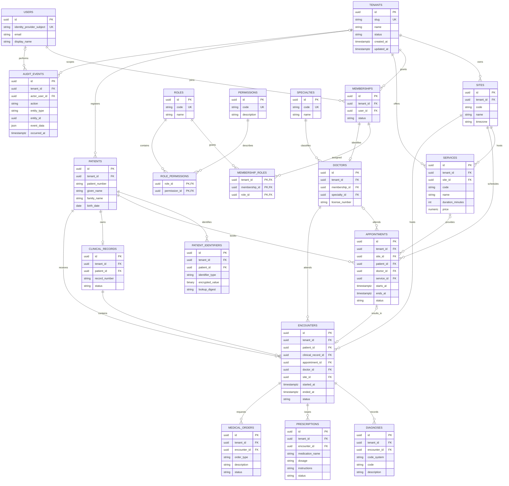

# Modelo de datos inicial

Diagrama lógico de persistencia del Día 2. Todas las claves primarias son UUID. Las entidades de negocio tienen `created_at` y `updated_at` UTC; `audit_events` usa `occurred_at`, y las tablas puente solo contienen las claves de relación.

## Decisiones de integridad

- Las referencias entre entidades tenant-scoped usan claves foráneas compuestas `(tenant_id, id)` (y, cuando aplica, también `patient_id`) para rechazar relaciones entre establecimientos distintos desde PostgreSQL.
- Cada recurso tenant-scoped conserva además una FK a `tenants`. Los índices de citas, pacientes, atenciones y auditoría comienzan por `tenant_id`.
- Los estados y límites temporales/precios tienen restricciones `CHECK`; códigos y números tienen unicidad global o por tenant/sede según corresponda.
- Los identificadores de pacientes almacenan `encrypted_value` y `lookup_digest`, no el identificador original en texto claro. La gestión de claves y cifrado/digest en servicios de aplicación queda fuera del alcance de este esquema.
- `audit_events.event_data` es para metadatos técnicos permitidos; no debe contener secretos ni información clínica.
- El esquema no crea RLS ni datos semilla: las políticas PostgreSQL, permisos y flujos de negocio son trabajo posterior.
